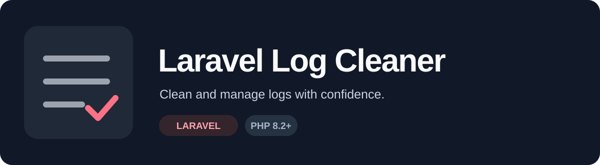

<div align="center">
  

  <p><strong>Clean up Laravel logs safely, without the clutter.</strong></p>

  <p>
    <a href="https://packagist.org/packages/jiordiviera/laravel-log-cleaner"></a>
    <a href="https://packagist.org/packages/jiordiviera/laravel-log-cleaner"></a>
    <a href="https://github.com/jiordiviera/laravel-log-cleaner/actions/workflows/tests.yml"></a>
    <a href="LICENSE.md"></a>
  </p>
</div>

Laravel Log Cleaner is a lightweight Laravel package that removes old log entries using an Artisan command. Preview changes first, keep backups, compress removed entries and handle large files using streaming.

## Installation

```bash
composer require jiordiviera/laravel-log-cleaner
```

**Requirements:** PHP 8.2+ and Laravel 10–13. Laravel 13 requires PHP 8.3+. Actual compatibility also depends on the framework's PHP requirements. See [Packagist](https://packagist.org/packages/jiordiviera/laravel-log-cleaner) for older releases.

## Quick start

```bash
# Remove all logs
php artisan log:clear

# Remove entries older than 30 days
php artisan log:clear --days=30

# Preview changes without modifying files
php artisan log:clear --days=30 --dry-run

# Create a backup before cleaning
php artisan log:clear --days=30 --backup
```

## Features

- **Safe cleanup:** dry-run, cooperative file locking, backups and checks before replacing files.
- **Targeted retention:** choose age, log level, custom date pattern or a specific file.
- **Compression:** save removed entries in a gzip archive.
- **Large files:** stream data to reduce peak memory use.
- **Integrations:** Laravel facade, configurable defaults and lifecycle events.

## Command options

| Option | Purpose |
| --- | --- |
| `--days=30` | Remove entries older than 30 days |
| `--dry-run` | Preview cleanup without writing |
| `--backup` | Back up a log before modifying it |
| `--compress` | Archive removed entries as gzip |
| `--level=ERROR` | Filter by log level |
| `--pattern=REGEX` | Use a custom date pattern |
| `--file=laravel.log` | Select one log file |
| `--memory-efficient` | Force streaming mode |
| `--no-lock` | Disable cooperative cleanup locking |
| `--no-events` | Disable cleanup events |

For example:

```bash
php artisan log:clear --days=7 --backup --compress
php artisan log:clear --days=30 --file=laravel.log --dry-run
php artisan log:clear --days=0 --level=ERROR
```

## Programmatic usage

```php
use JiordiViera\LaravelLogCleaner\LogCleanerFacade as LogCleaner;

LogCleaner::clearAll();
LogCleaner::clearOld(30);
LogCleaner::clearWithBackup(30);
LogCleaner::clearWithCompression(30);

LogCleaner::clear(
    days: 30,
    backup: true,
    compress: true,
    file: 'laravel.log'
);
```

## Configuration

Publish the optional configuration file:

```bash
php artisan vendor:publish --tag="log-cleaner-config"
```

You can adjust the memory threshold, backup retention, compression level, default log level, file-lock timeout and event dispatching in `config/log-cleaner.php`.

## Events and exceptions

Listen to these events to observe cleanup:

- `LogCleaning` — before cleanup starts.
- `LogFileCleaned` — after a file has been cleaned.
- `LogCleaned` — after cleanup completes.

The package also provides dedicated exceptions for invalid parameters, permissions, disk space, backups, locking and compression. See the classes in [`src/Exceptions`](src/Exceptions).

## Development

```bash
composer install
composer test
composer analyse
composer lint
```

Tests use **Pest**; formatting uses **Laravel Pint**; static analysis runs **PHPStan level 4**. The CI matrix covers PHP 8.2/8.3 with Laravel 10–12, plus PHP 8.3 with Laravel 13.

## Important limitations

- **Concurrent writers:** locks coordinate participating cleanup processes, not unrelated log writers. A write between the final integrity check and replacement may still race.
- **Multiline logs:** continuation lines follow the last recognized log header. Unrecognized, undated content may be retained.
- **Disk space:** streaming and backups still need free space for temporary files and archives.
- **Compression:** requires PHP's `zlib` extension.

## Releases and contributions

Changes merged into `main` are **not necessarily published** on Packagist. See the [changelog](CHANGELOG.md) for release history and unreleased changes. The next planned minor release is **v2.3.0**, preserving the v2 public API.

Issues and pull requests are welcome in the [GitHub repository](https://github.com/jiordiviera/laravel-log-cleaner).

Released under the [MIT License](LICENSE.md).
